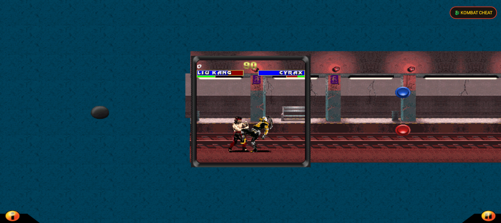

# 🐉 Ultimate Mortal Kombat 3 — Android Port + Kombat Cheat

[](https://github.com/GUPRON98/UltimateMortalKombat3-Android)
[](https://github.com/GUPRON98/UltimateMortalKombat3-Android)

Port Android dari **Ultimate Mortal Kombat 3** (Samsung GT-S8000 `480x800`) dengan tampilan **Landscape Fullscreen**, **Touchscreen Controls**, dan **Built-in Kombat Cheat (`🐉 KOMBAT CHEAT`)**.

---

## 📸 Screenshots

| Splash Screen (Landscape) | Gameplay / Demo |
| :---: | :---: |
|  |  |

---

## ⚡ Fitur Utama

- 📱 **Landscape Fullscreen (`800x480`)**: Orientasi `sensorLandscape` yang sesuai dengan framebuffer `480x800` game.
- 🐉 **Built-in Kombat Cheat (`🐉 KOMBAT CHEAT`)**: Menu cheat terintegrasi di pojok kanan atas layar.
- 👆 **Full Touchscreen Support**: Kontrol sentuh native langsung di layar.

---

## 📦 Download APK

Unduh file APK siap pasang:
- **[UltimateMortalKombat3.apk](UltimateMortalKombat3.apk)** (`minSdkVersion 21`, pure Java/Smali tanpa native `.so`)

---

## 🛠️ Build dari Source (Termux / Linux)

```bash
apktool b . -o unaligned.apk
zipalign -f 4 unaligned.apk UltimateMortalKombat3.apk
apksigner sign --ks umk3.keystore --ks-key-alias umk3 --ks-pass pass:umk3123456 --key-pass pass:umk3123456 UltimateMortalKombat3.apk
```
